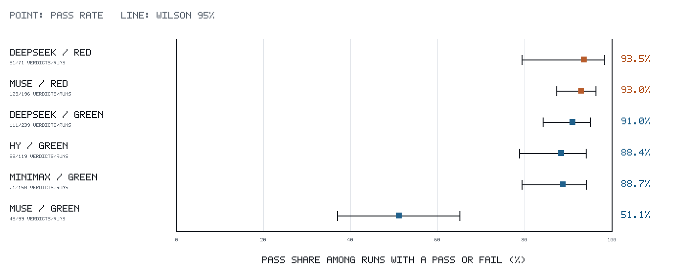
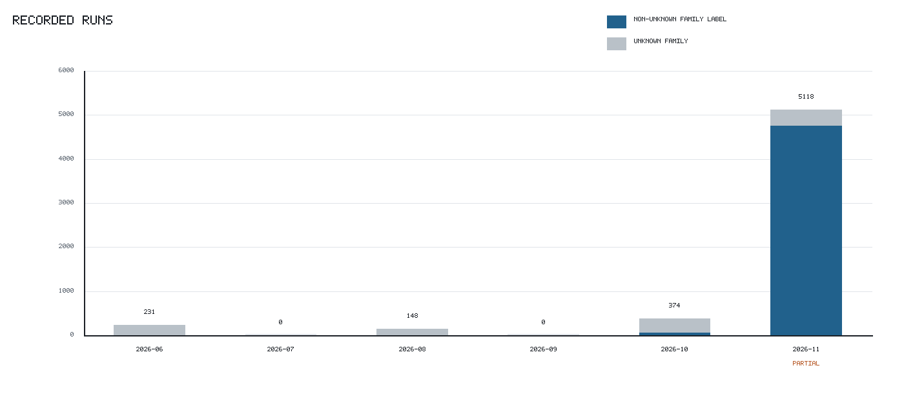

**Version:** v0.3\
**Date:** 2026-11-27

## Abstract {.unnumbered}

Between June and November 2026, we examine 5,871 runs across 68 route labels and 17 family labels in an engineering workflow. Records occur in four months, with 87.2% of runs in November; selection, repeated work and missing verdicts limit comparisons. Producers passed 674 of 753 verdicts (89.5%; Wilson 95% interval 87.1 to 91.5%; coverage 46.1%). Reviewers approved 2,681 of 3,516 verdicts (76.3%; interval 74.8 to 77.6%; coverage 82.9%). We describe findings, rater scores, cost classes and three routing trials: Jev instrumentation, Sonnet effort and HungerG production. The benchmark supplement uses three HungerG runs per arm; Arm A ranges overlap (92.8 to 95.7; historical DeepSeek 90.9 to 95.0). Arm B HungerG scores span 95.8 to 100.0; the historical reference has a single score of 97.7. Different fixture revisions prevent controlled comparisons across models; the operational record has no routing baseline or evidence of routing benefit.

# Introduction

Agent-based software engineering changes the unit of model selection. The orchestrator can assign a model to write tests and another to implement the change. Other models check the change. Each assignment has a different objective. A reviewer can reject an artifact and thereby help the task succeed. An implementation agent must satisfy a contract and produce working code.

A route is also a deployment choice. Providers can expose the same family through different endpoints or effort settings. Route availability and independent review constrain the choice. We study these assignments in a spec-driven workflow called Measure. The records include software engineering, documentation, curriculum work and benchmark work.

We ask four questions of the records:

- **RQ1.** Do observed family-role differences persist when we examine missing verdicts and exclude individual directories?
- **RQ2.** Do recorded finding frequencies differ when we restrict the denominator to decision runs?
- **RQ3.** Do the observed route classes and months show a uniform distribution of recorded work?
- **RQ4.** Do recorded rater scores and raw agreement provide independent evidence of artifact correctness?

# Setting

## Spec-driven work and role boundaries

Measure divides work into tracks. Each track contains a specification and a phased plan. The orchestrator assigns an agent a bounded task and its evidence. A role specifies a responsibility. A route specifies an endpoint and effort setting.

The strategy role prepares the implementation approach. The Red role writes tests that should fail until the specified behavior exists. The Green role implements the behavior and reruns the checks. The orchestrator requests different families for Red and Green where the independence rule applies. The coder, record and small roles perform bounded tasks.

Review A checks correctness and architecture. Review B checks applicable security and data risks. Review C checks interface and user flow contracts. Adversarial testing checks edge cases and evidence. Spec review checks the planned work. Vision review checks visual evidence. Phase acceptance checks a phase at a fixed revision. Final acceptance checks the completed track. We retain the separate acceptance label in the records.

The role groups distinguish producers from decision roles. Decision roles comprise review-a, review-b, review-c, adversarial, spec-review, vision-review, acceptance, phase-acceptance and final-acceptance. All other observed roles are producers. A producer pass records a work result. A decision pass records an approval. Under the independence rule, reviewers come from families other than the producer family. A stricter reviewer can lower the recorded pass rate of the producers it reviews. The export has no direct key that links a producer to reviewer verdicts on its artifact. Shared sessions or task tags do not establish that link.

A task can require implementation followed by review and correction. The orchestrator can assign another run after a failed gate. A run is therefore not a count of distinct tasks or defects.

## Route selection

Project management is a role that sets or approves route policy. The routing tool uses ordered route lists by role. It checks route eligibility and availability. It also checks family exclusions for independent review. The tool returns the first eligible route or reports that none is available. Project management can record a substitution.

The policy changed during the period. On November 24, the phase-acceptance effort policy moved away from max. We treat Sonnet labels under `claude-code` and `claude-agent` as the same recorded family. We do not assume that earlier assignments followed the later policy.

# Data and method

## Population and reproducibility

We select runs whose recorded start time is at or before 2026-11-26T22:21:52Z. The first record has start time 2026-06-06T23:43:33Z. The dataset contains 5,871 runs in 23 anonymous directories and 15 roles. We retain all domains and legacy records. Directory identifiers do not denote distinct projects.

The frozen SQLite copy, `outcomes-20261127T083716761728Z.sqlite`, dates to 2026-11-27T08:37Z. Its SHA-256 is:

`59eddd0eb34019870463451367f5f059a176331b00acab0beb30b295776e89b0`

The script `paper1_tables.py` uses `--from-snapshot` and the cutoff to build the aggregates from the copy. Version v0.2 used an earlier copy. The CSV arithmetic reproduces from the frozen copy. The trial rows come from private files and contain counts and numeric summaries only. The trial extract does not permit a recount of all underlying private records.

We normalize a route by taking the first stored token and removing trailing punctuation. The lookup then applies ordered string rules without regard to case. Family denotes a label and can group multiple routes. The label does not verify the executed model. Appendix A lists the rules, examples and residual labels.

We classify domains by directory name. The map assigns code, markdown or curriculum, and benchmark work. The classification of dir_08 (302 runs) and four additional directories with few runs is uncertain. The mixed domain population limits the interpretation of pooled comparisons.

## Measures and analysis

Let P be the number of passes, F the number of failures and N the number of runs. A verdict is a pass or fail. The conditional rate is P/(P+F), and coverage is (P+F)/N. We call the conditional rate an approval rate for decision roles. The lower bound is P/N; the upper bound is (N−F)/N. These bounds treat every run without a binary verdict as a failure or a pass, respectively.

We group explicit no_verdict and NULL results as no verdict. We group error, timeout and abandoned results as errors. We retain all runs in N. A conditional rate is undefined if no verdict exists.

We calculate percentages from integer counts and round once. We report Wilson 95% intervals for binary proportions. These intervals describe run-level uncertainty and do not adjust for clustered observations. The bounds describe missing outcomes and are not confidence intervals. Repeated assignments and selective allocation prevent inference from an independent random sample.

Table 1 includes every family-role cell with at least 30 verdicts. Appendix B marks and reports cells below this minimum. The full 138-cell table remains in `by_family_role.csv`. For each main cell, we exclude each directory in turn and report the minimum and maximum remaining rate. The sensitivity export stores these extrema to four decimal places. This sensitivity analysis does not adjust for task difficulty.

Finding frequencies use decision-role runs as the denominator. An escape is a severity label: `escaped = 1` if and only if `severity = escape`. We verified this relation for all 8,679 selected findings. Findings per run can exceed unity, so a binomial Wilson interval does not apply to this frequency.

The rating rubric uses scores from 1 through 5. Model reviewers in decision roles record scores; human judges do not supply these ratings. The given view groups by rater route. The received view groups by the family of the rated run. The data lack a direct link to the producer of the rated artifact. Consequently, the received view cannot establish a producer-family rating. Review accuracy and agreement describe the same check. We report the agreement once, with the checker family.

The cost map records the route class at extraction. Subscription, credit and free are classifications of routes. Unknown means the map lacks a class. These classes do not measure spend or token consumption.

# Results

## RQ1: Family-role verdicts and sensitivity

The snapshot contains 3,355 passes and 914 failures. It contains 897 explicit no-verdict results and 622 NULL results. The error class contains 70 errors, zero timeouts and 13 abandonments.

The aggregate role groups have the following outcomes. Coverage intervals refer to all runs; conditional-rate intervals use verdicts.

| Role group | P/V/N | Coverage % (CI) | Rate % | CI % | Bounds % |
| :--- | ---: | ---: | ---: | ---: | ---: |
| producer | 674/753/1632 | 46.1 (43.7–48.6) | 89.5 | 87.1–91.5 | 41.3–95.2 |
| decision | 2681/3516/4239 | 82.9 (81.8–84.0) | 76.3 | 74.8–77.6 | 63.2–80.3 |

Table 1 first lists producer cells and then decision cells. The coverage of all Green runs is 46.6% (319 of 685; CI 42.9–50.3%). For all Red runs, coverage is 48.8% (202 of 414; CI 44.0–53.6%). Producer observations are partial. The table includes the missing-outcome bounds and leave-one-directory-out range for each cell.

| Role | Family | P/V/N | Cov. | Rate | CI | Bounds | LOO |
| :--- | :--- | ---: | ---: | ---: | ---: | ---: | ---: |
| green | deepseek | 101/111/239 | 46.4 | 91.0 | 84.2–95.0 | 42.3–95.8 | 88.9–92.2 |
| green | hy | 61/69/119 | 58.0 | 88.4 | 78.8–94.0 | 51.3–93.3 | 87.3–90.4 |
| green | minimax | 63/71/150 | 47.3 | 88.7 | 79.3–94.2 | 42.0–94.7 | 86.9–90.6 |
| green | muse | 23/45/99 | 45.5 | 51.1 | 37.0–65.0 | 23.2–77.8 | 40.5–91.3 |
| record | hy | 29/31/51 | 60.8 | 93.5 | 79.3–98.2 | 56.9–96.1 | 90.9–96.3 |
| record | minimax | 29/32/56 | 57.1 | 90.6 | 75.8–96.8 | 51.8–94.6 | 85.7–93.3 |
| red | deepseek | 29/31/71 | 43.7 | 93.5 | 79.3–98.2 | 40.8–97.2 | 92.6–96.2 |
| red | muse | 120/129/196 | 65.8 | 93.0 | 87.3–96.3 | 61.2–95.4 | 92.2–94.8 |
| strategy | hy | 33/34/49 | 69.4 | 97.1 | 85.1–99.5 | 67.3–98.0 | 96.2–100.0 |
| adversarial | claude | 26/42/50 | 84.0 | 61.9 | 46.8–75.0 | 52.0–68.0 | 60.0–66.7 |
| adversarial | glm | 34/52/60 | 86.7 | 65.4 | 51.8–76.8 | 56.7–70.0 | 60.0–78.4 |
| adversarial | hy | 22/35/46 | 76.1 | 62.9 | 46.3–76.8 | 47.8–71.7 | 58.1–81.2 |
| adversarial | muse | 20/37/41 | 90.2 | 54.1 | 38.4–69.0 | 48.8–58.5 | 50.0–58.6 |
| adversarial | openai | 64/99/109 | 90.8 | 64.6 | 54.8–73.4 | 58.7–67.9 | 60.0–71.1 |
| adversarial | unknown | 133/158/164 | 96.3 | 84.2 | 77.7–89.0 | 81.1–84.8 | 78.0–87.0 |
| phase-acceptance | claude | 120/146/165 | 88.5 | 82.2 | 75.2–87.5 | 72.7–84.2 | 79.4–84.1 |
| phase-acceptance | glm | 42/45/56 | 80.4 | 93.3 | 82.1–97.7 | 75.0–94.6 | 90.6–97.4 |
| phase-acceptance | openai | 34/59/64 | 92.2 | 57.6 | 44.9–69.4 | 53.1–60.9 | 51.1–63.3 |
| phase-acceptance | unknown | 143/153/156 | 98.1 | 93.5 | 88.4–96.4 | 91.7–93.6 | 91.2–96.4 |
| review-a | claude | 96/133/149 | 89.3 | 72.2 | 64.0–79.1 | 64.4–75.2 | 70.6–74.7 |
| review-a | deepseek | 54/71/120 | 59.2 | 76.1 | 65.0–84.5 | 45.0–85.8 | 70.0–88.5 |
| review-a | glm | 75/97/120 | 80.8 | 77.3 | 68.0–84.5 | 62.5–81.7 | 73.2–85.0 |
| review-a | mimo | 59/73/85 | 85.9 | 80.8 | 70.3–88.2 | 69.4–83.5 | 78.0–83.9 |
| review-a | minimax | 60/89/105 | 84.8 | 67.4 | 57.1–76.3 | 57.1–72.4 | 62.3–70.6 |
| review-a | muse | 47/53/76 | 69.7 | 88.7 | 77.4–94.7 | 61.8–92.1 | 87.2–91.3 |
| review-a | openai | 197/358/408 | 87.7 | 55.0 | 49.8–60.1 | 48.3–60.5 | 53.7–58.4 |
| review-a | unknown | 250/310/322 | 96.3 | 80.6 | 75.9–84.7 | 77.6–81.4 | 79.8–81.4 |
| review-b | claude | 45/53/67 | 79.1 | 84.9 | 72.9–92.1 | 67.2–88.1 | 82.6–86.7 |
| review-b | deepseek | 34/46/68 | 67.6 | 73.9 | 59.7–84.4 | 50.0–82.4 | 68.8–85.0 |
| review-b | glm | 33/37/47 | 78.7 | 89.2 | 75.3–95.7 | 70.2–91.5 | 88.0–92.0 |
| review-b | hy | 39/45/86 | 52.3 | 86.7 | 73.8–93.7 | 45.3–93.0 | 82.9–97.1 |
| review-b | kimi | 93/109/122 | 89.3 | 85.3 | 77.5–90.8 | 76.2–86.9 | 81.6–87.9 |
| review-b | unknown | 142/179/182 | 98.4 | 79.3 | 72.8–84.6 | 78.0–79.7 | 75.4–82.0 |
| review-c | claude | 43/56/60 | 93.3 | 76.8 | 64.2–85.9 | 71.7–78.3 | 74.5–80.0 |
| review-c | glm | 40/54/72 | 75.0 | 74.1 | 61.1–83.9 | 55.6–80.6 | 68.9–78.6 |
| review-c | muse | 29/30/42 | 71.4 | 96.7 | 83.3–99.4 | 69.0–97.6 | 92.9–100.0 |
| review-c | openai | 84/114/138 | 82.6 | 73.7 | 64.9–80.9 | 60.9–78.3 | 69.7–80.6 |
| review-c | unknown | 170/194/197 | 98.5 | 87.6 | 82.3–91.5 | 86.3–87.8 | 85.4–90.2 |

: Table 1. Family-role cells. P/V/N = passes/verdicts/runs. All rate columns use percent. CI = Wilson interval; bounds = all missing fail or pass; LOO = directory exclusion range.

The worked example shows the concentration of verdicts in dir_03. Muse Green passed 23 of 45 verdicts overall. Within dir_03 it passed 2 of 22 verdicts; outside it passed 21 of 23 (91.3%). The failures within that directory occurred from November 20 to 22. The two busiest dates account for 19 of the cell's 22 failures.

The free DeepSeek route shows the same concentration. It passed 2 of 33 verdicts inside dir_03 and 31 of 45 (68.9%) outside. The same directory contributes failures to both cells. The directory split in Table 2 shows why the overall cell rates cannot establish stable role or route effects.

| Cell | Scope | P/V/N | Cov. | Rate | CI |
| :--- | :--- | ---: | ---: | ---: | ---: |
| Muse Green | inside * | 2/22/26 | 84.6 | 9.1 | 2.5–27.8 |
| Muse Green | outside * | 21/23/73 | 31.5 | 91.3 | 73.2–97.6 |
| DeepSeek free | inside | 2/33/35 | 94.3 | 6.1 | 1.7–19.6 |
| DeepSeek free | outside | 31/45/149 | 30.2 | 68.9 | 54.3–80.5 |

: Table 2. Directory sensitivity example. An asterisk marks fewer than 30 verdicts. Rates, coverage and intervals use percent.

Figure 1 displays selected producer verdicts and their run-level intervals before directory exclusion. The figure alone cannot show the cluster effects that Table 2 describes.

Decision roles have a different objective. A lower approval rate can indicate more stringent checks or more difficult work. It can also indicate poor review performance. The records cannot distinguish these explanations.

Table 3 separates the domain and role groups. The producer and decision rates differ in each domain. These differences are descriptive because the tasks differ.

| Domain | Group | P/V/N | Cov. | Rate | CI | Share |
| :--- | :--- | ---: | ---: | ---: | ---: | ---: |
| benchmark | decision | 277/371/449 | 82.6 | 74.7 | 70.0–78.8 | 7.6 |
| benchmark | producer | 69/75/175 | 42.9 | 92.0 | 83.6–96.3 | 3.0 |
| code | decision | 1582/2104/2443 | 86.1 | 75.2 | 73.3–77.0 | 41.6 |
| code | producer | 379/439/840 | 52.3 | 86.3 | 82.8–89.2 | 14.3 |
| markdown/curriculum | decision | 822/1041/1347 | 77.3 | 79.0 | 76.4–81.3 | 22.9 |
| markdown/curriculum | producer | 226/239/617 | 38.7 | 94.6 | 90.9–96.8 | 10.5 |

: Table 3. Domain and role group. Share is the share of all runs. Coverage and conditional rates use percent.

## RQ2: Recorded findings

Table 4 uses the decision-run denominator for each family. It includes findings that the decision run records, rather than a count of distinct defects. The observed frequencies differ even with that denominator. Escape frequencies do not identify which family missed a defect at an earlier gate.

| Family | Runs | Cov. % | Findings | Escapes | F/run | E/100 |
| :--- | ---: | ---: | ---: | ---: | ---: | ---: |
| beam * | 30 | 80.0 | 19 | 6 | 0.63 | 20.0 |
| claude | 553 | 85.2 | 1848 | 10 | 3.34 | 1.8 |
| deepseek | 348 | 55.7 | 347 | 15 | 1.00 | 4.3 |
| doubao * | 1 | 100.0 | 2 | 0 | 2.00 | 0.0 |
| glm | 373 | 77.5 | 556 | 12 | 1.49 | 3.2 |
| hy | 155 | 61.3 | 42 | 15 | 0.27 | 9.7 |
| kimi | 224 | 85.3 | 263 | 15 | 1.17 | 6.7 |
| mimo | 153 | 77.1 | 287 | 7 | 1.88 | 4.6 |
| minimax | 206 | 80.1 | 437 | 18 | 2.12 | 8.7 |
| muse | 235 | 76.6 | 292 | 5 | 1.24 | 2.1 |
| nemotron * | 1 | 0.0 | 0 | 0 | 0.00 | 0.0 |
| openai | 796 | 84.4 | 1061 | 61 | 1.33 | 7.7 |
| other-cn-infra * | 2 | 100.0 | 3 | 1 | 1.50 | 50.0 |
| qwen | 37 | 81.1 | 97 | 5 | 2.62 | 13.5 |
| stepfun | 78 | 83.3 | 126 | 5 | 1.62 | 6.4 |
| unknown | 1047 | 97.3 | 3299 | 50 | 3.15 | 4.8 |

: Table 4. Findings and escapes per decision run. Coverage refers to verdicts on decision runs. Findings and escapes are event counts, not binary proportions. An asterisk marks fewer than 30 verdicts.

Different opportunities to inspect artifacts can change the frequencies. The unknown family also contains legacy severity labels that differ from the current taxonomy. We have no common set of defects against which to estimate precision or recall.

## RQ3: Cost classes and record periods

Table 5 reports the observed distribution under the extraction-time route map. The unknown class covers 1,291 runs on 20 routes. It includes 1,047 legacy unknown-family runs and 244 runs on 19 named routes without a mapping. One Muse route accounts for 609 of the 616 credit-class runs. Class shares do not quantify cost differences. We do not compare conditional pass rates by cost class.

| Class | Runs | Routes | Share | Share CI | Cov. |
| :--- | ---: | ---: | ---: | ---: | ---: |
| credit | 616 | 3 | 10.5 | 9.7–11.3 | 62.0 |
| free | 828 | 13 | 14.1 | 13.2–15.0 | 55.9 |
| subscription | 3136 | 32 | 53.4 | 52.1–54.7 | 72.4 |
| unknown | 1291 | 20 | 22.0 | 20.9–23.1 | 89.2 |

: Table 5. Route classes. Share and verdict coverage use percent. Intervals refer to the share of runs in each class.

Figure 2 shows records in June, August, October and November. It includes the months with no records and marks November as partial. November accounts for 5,118 of 5,871 records (87.2%). June and August records carry the unknown family label; the composition of subsequent records differs.

Table 6 gives the period counts and the pooled sensitivity comparison. The unknown label accounts for 1,047 runs and has no explicit no-verdict or NULL results. It still contains errors. The non-unknown population excludes these legacy rows, but retains residual labels. The pooled rate combines unlike outcomes and primarily describes the November policy.

| Population | P/V/N | Cov. % | Rate % | CI % | Bounds % |
| :--- | ---: | ---: | ---: | ---: | ---: |
| 2026-06 | 222/230/231 | 99.6 | 96.5 | 93.3–98.2 | 96.1–96.5 |
| 2026-07 | 0/0/0 | — | — | — | — |
| 2026-08 | 146/148/148 | 100.0 | 98.6 | 95.2–99.6 | 98.6–98.6 |
| 2026-09 | 0/0/0 | — | — | — | — |
| 2026-10 | 266/361/374 | 96.5 | 73.7 | 68.9–78.0 | 71.1–74.6 |
| 2026-11 | 2721/3530/5118 | 69.0 | 77.1 | 75.7–78.4 | 53.2–84.2 |
| Pooled | 3355/4269/5871 | 72.7 | 78.6 | 77.3–79.8 | 57.1–84.4 |
| Without unknown | 2496/3250/4824 | 67.4 | 76.8 | 75.3–78.2 | 51.7–84.4 |
| Unknown only | 859/1019/1047 | 97.3 | 84.3 | 81.9–86.4 | 82.0–84.7 |

: Table 6. Months and population sensitivity. P/V/N = passes/verdicts/runs. The pooled rates combine producer passes and decision approvals.

## RQ4: Recorded rater scores

Tables 7 and 8 report the axes for correctness, evidence quality, scope discipline and test meaning. They give medians and the share of scores at or below 3. The two Muse evidence labels have different names. We retain them separately. The exporter renamed four Muse test_mean rows to test_meaning and kept their evidence unchanged. Consequently, Muse has different counts by axis.

| Family | Correctness | Evidence quality | Scope discipline | Test meaning |
| :--- | ---: | ---: | ---: | ---: |
| beam | 8*; 5; 0.0 (0.0–32.4) | 8*; 5; 0.0 (0.0–32.4) | 8*; 5; 0.0 (0.0–32.4) | 8*; 5; 12.5 (2.2–47.1) |
| claude | 239; 4; 20.5 (15.9–26.1) | 239; 4; 8.8 (5.8–13.1) | 239; 5; 0.8 (0.2–3.0) | 239; 4; 33.9 (28.2–40.1) |
| deepseek | 46; 4; 21.7 (12.3–35.6) | 46; 5; 8.7 (3.4–20.3) | 46; 5; 0.0 (0.0–7.7) | 46; 4; 28.3 (17.3–42.5) |
| glm | 172; 5; 10.5 (6.7–15.9) | 172; 5; 2.9 (1.2–6.6) | 172; 5; 0.0 (0.0–2.2) | 172; 4; 14.0 (9.6–19.9) |
| hy | 24*; 5; 8.3 (2.3–25.8) | 24*; 5; 0.0 (0.0–13.8) | 24*; 5; 0.0 (0.0–13.8) | 24*; 4; 4.2 (0.7–20.2) |
| kimi | 108; 5; 20.4 (13.9–28.9) | 108; 5; 1.9 (0.5–6.5) | 108; 5; 0.0 (0.0–3.4) | 108; 4; 14.8 (9.3–22.7) |
| mimo | 68; 4; 16.2 (9.3–26.7) | 68; 5; 1.5 (0.3–7.9) | 68; 5; 0.0 (0.0–5.3) | 68; 4; 20.6 (12.7–31.6) |
| minimax | 67; 4; 26.9 (17.7–38.5) | 67; 4; 3.0 (0.8–10.2) | 67; 5; 0.0 (0.0–5.4) | 67; 4; 22.4 (14.1–33.7) |
| muse | 104; 5; 11.5 (6.7–19.1) | 102; 5; 0.0 (0.0–3.6) | 104; 5; 1.0 (0.2–5.2) | 104; 5; 2.9 (1.0–8.1) |
| openai | 442; 4; 38.7 (34.3–43.3) | 442; 5; 7.9 (5.7–10.8) | 442; 5; 2.7 (1.6–4.7) | 442; 4; 35.3 (31.0–39.9) |
| other-cn-infra | 2*; 4; 50.0 (9.5–90.5) | 2*; 5; 0.0 (0.0–65.8) | 2*; 5; 0.0 (0.0–65.8) | 2*; 4; 0.0 (0.0–65.8) |
| qwen | 18*; 5; 0.0 (0.0–17.6) | 18*; 5; 0.0 (0.0–17.6) | 18*; 5; 0.0 (0.0–17.6) | 18*; 4; 0.0 (0.0–17.6) |
| stepfun | 24*; 5; 16.7 (6.7–35.9) | 24*; 5; 4.2 (0.7–20.2) | 24*; 5; 0.0 (0.0–13.8) | 24*; 5; 12.5 (4.3–31.0) |
| unknown | 66; 4; 36.4 (25.8–48.4) | 66; 4.5; 4.5 (1.6–12.5) | 66; 5; 1.5 (0.3–8.1) | 66; 4; 31.8 (21.8–43.8) |
| muse: evidence | — | 2*; 4; 0.0 (0.0–65.8) | — | — |

: Table 7. Scores given by rater family. Each cell reports n; median; percent at or below 3 (Wilson interval). An asterisk marks n below 30.

| Family | Correctness | Evidence quality | Scope discipline | Test meaning |
| :--- | ---: | ---: | ---: | ---: |
| beam | 8*; 5; 0.0 (0.0–32.4) | 8*; 5; 0.0 (0.0–32.4) | 8*; 5; 0.0 (0.0–32.4) | 8*; 5; 12.5 (2.2–47.1) |
| claude | 245; 4; 20.0 (15.5–25.5) | 245; 4; 8.6 (5.7–12.7) | 245; 5; 0.8 (0.2–2.9) | 245; 4; 33.5 (27.9–39.6) |
| deepseek | 46; 4; 21.7 (12.3–35.6) | 46; 5; 8.7 (3.4–20.3) | 46; 5; 0.0 (0.0–7.7) | 46; 4; 28.3 (17.3–42.5) |
| glm | 172; 5; 10.5 (6.7–15.9) | 172; 5; 2.9 (1.2–6.6) | 172; 5; 0.0 (0.0–2.2) | 172; 4; 14.0 (9.6–19.9) |
| hy | 24*; 5; 8.3 (2.3–25.8) | 24*; 5; 0.0 (0.0–13.8) | 24*; 5; 0.0 (0.0–13.8) | 24*; 4; 4.2 (0.7–20.2) |
| kimi | 108; 5; 20.4 (13.9–28.9) | 108; 5; 1.9 (0.5–6.5) | 108; 5; 0.0 (0.0–3.4) | 108; 4; 14.8 (9.3–22.7) |
| mimo | 68; 4; 16.2 (9.3–26.7) | 68; 5; 1.5 (0.3–7.9) | 68; 5; 0.0 (0.0–5.3) | 68; 4; 20.6 (12.7–31.6) |
| minimax | 67; 4; 26.9 (17.7–38.5) | 67; 4; 3.0 (0.8–10.2) | 67; 5; 0.0 (0.0–5.4) | 67; 4; 22.4 (14.1–33.7) |
| muse | 104; 5; 11.5 (6.7–19.1) | 102; 5; 0.0 (0.0–3.6) | 104; 5; 1.0 (0.2–5.2) | 104; 5; 2.9 (1.0–8.1) |
| openai | 442; 4; 38.7 (34.3–43.3) | 442; 5; 7.9 (5.7–10.8) | 442; 5; 2.7 (1.6–4.7) | 442; 4; 35.3 (31.0–39.9) |
| other-cn-infra | 2*; 4; 50.0 (9.5–90.5) | 2*; 5; 0.0 (0.0–65.8) | 2*; 5; 0.0 (0.0–65.8) | 2*; 4; 0.0 (0.0–65.8) |
| qwen | 18*; 5; 0.0 (0.0–17.6) | 18*; 5; 0.0 (0.0–17.6) | 18*; 5; 0.0 (0.0–17.6) | 18*; 4; 0.0 (0.0–17.6) |
| stepfun | 24*; 5; 16.7 (6.7–35.9) | 24*; 5; 4.2 (0.7–20.2) | 24*; 5; 0.0 (0.0–13.8) | 24*; 5; 12.5 (4.3–31.0) |
| unknown | 60; 4; 40.0 (28.6–52.6) | 60; 5; 5.0 (1.7–13.7) | 60; 5; 1.7 (0.3–8.9) | 60; 4; 33.3 (22.7–45.9) |
| muse: evidence | — | 2*; 4; 0.0 (0.0–65.8) | — | — |

: Table 8. Scores received by the family of the rated run. Each cell reports n; median; percent at or below 3 (Wilson interval). These are not producer-family scores.

The agreement checks are a separate interpretation of the review-accuracy measure. They do not supply independent observations. Table 9 groups them by checker family and includes the median review-accuracy score given by that checker family. We can also group checks by the family of the reviewer run. In this grouping, checks of Muse reviews show agreement on 25 of 31 checks (80.6%; CI 63.7–90.8%). The checker-family grouping gives a different Muse count. Agreement cannot establish correctness because both models can agree on an incorrect judgment.

| Checker | Agreed | Disagreed | Agree % | CI % | Median | ≤3 % (CI) |
| :--- | ---: | ---: | ---: | ---: | ---: | ---: |
| claude | 193 | 13 | 93.7 | 89.5–96.3 | 4 | 10.7 (7.2–15.6) |
| deepseek * | 3 | 0 | 100.0 | 43.9–100.0 | 5 | 0.0 (0.0–56.1) |
| glm | 90 | 0 | 100.0 | 95.9–100.0 | 5 | 0.0 (0.0–4.1) |
| kimi * | 9 | 2 | 81.8 | 52.3–94.9 | 4 | 36.4 (15.2–64.6) |
| mimo * | 4 | 0 | 100.0 | 51.0–100.0 | 4.5 | 0.0 (0.0–49.0) |
| minimax * | 10 | 0 | 100.0 | 72.2–100.0 | 4 | 0.0 (0.0–27.8) |
| muse | 38 | 1 | 97.4 | 86.8–99.5 | 5 | 2.6 (0.5–13.2) |
| openai | 94 | 27 | 77.7 | 69.5–84.2 | 4 | 29.8 (22.3–38.4) |
| qwen * | 6 | 2 | 75.0 | 40.9–92.9 | 5 | 25.0 (7.1–59.1) |
| stepfun * | 19 | 0 | 100.0 | 83.2–100.0 | 5 | 0.0 (0.0–16.8) |
| unknown * | 19 | 1 | 95.0 | 76.4–99.1 | 5 | 5.0 (0.9–23.6) |

: Table 9. Review agreement by checker family. Score columns describe review-accuracy scores given by the checker. Agreement uses agreed plus disagreed checks. An asterisk marks fewer than 30 checks.

# Three routing trials

## Jev shadow routing: instrumentation result

Jev is a decision model that selects an eligible route from a task description and route menu. The original script retained control of live assignments during the shadow trial. The trial began on November 2 with a planned duration of four days. The hook skipped the call when task text was absent.

The initial period contained 398 decisions, including 211 without task text (53.0%; CI 48.1–57.9%). Table 10 accounts for the cumulative report after the atomic-mode extension. The original period and cumulative period have different denominators. The cumulative share without task text is 85.7% (1,488 of 1,736; CI 84.0–87.3%).

| Decision category | Count |
| :--- | ---: |
| Total | 1736 |
| Skipped | 1553 |
|   No task | 1488 |
|   No menu | 59 |
|   Menu under two | 6 |
| Not skipped | 183 |
|   Usable choice | 177 |
|   Other | 6 |
|     URLError | 4 |
|     TimeoutError | 1 |
|     Atomic answer without usable choice | 1 |

: Table 10. Cumulative shadow routing decisions. The category rows partition the corresponding subtotal.

Among usable choices, Jev agreed with the script on 54 of 177 (30.5%; CI 24.2–37.6%). The top choice remained stable after menu reordering on 139 of 177 (78.5%; CI 71.9–83.9%). The remaining cases indicate sensitivity to menu order. The cumulative log contains no live Jev assignments. The experiment therefore provides an instrumentation result and no estimate of Jev's effect on outcomes.

The trial restarted on 2026-11-27 with dispatcher instructions that require task text for every eligible assignment. The live arm has a 20% allocation probability for eligible disagreements in coder, red, green, small and record roles. The scheduled end date is 2026-12-11. Decision roles remain excluded. The model's choice must meet the same route eligibility rules as the script. This is a feasibility trial. The present paper reports no results from the restart.

## Sonnet effort in phase acceptance

Phase acceptance evaluates a completed phase and its evidence. The policy change creates a before-and-after description of two policy periods, without random allocation. The comparison tool matches sessions using the role-agent and run-window rule. It assigns each session to one run. We use the executed route when a session matches and the recorded route otherwise.

The recorded family matches the executed family for 19 of 22 matchable Sonnet runs (86.4%; CI 66.7–95.3%). Table 11 describes the two observed effort groups after excluding matched sessions outside those groups. Price equivalents use a constant fallback price for a previous model generation. They do not measure billed USD. The session clock uses session start to first recorded idle or end.

| Effort | Dates (UTC) | Matched | Est. USD | Minutes |
| :--- | :--- | ---: | ---: | ---: |
| xhigh | 2026-11-24 to 2026-11-26 | 6 | 4.85 (1.41–15.67) | 10.6 (4.1–20.9) |
| max | 2026-11-22 to 2026-11-24 | 13 | 7.84 (4.53–13.92) | 33.6 (17.7–117.6) |

: Table 11. Matched sessions by effort. Values are median (minimum to maximum). Dates refer to the full effort groups.

Table 12 describes verdicts and findings separately. The intersection of runs with matched sessions and findings evidence is zero in each effort group. We cannot associate cost or time with findings on the same run. The groups also differ in dates and assignments.

| Effort | Runs | Pass | Fail | No v. | Other | Cov. % | Evidence n | Findings | F/n |
| :--- | ---: | ---: | ---: | ---: | ---: | ---: | ---: | ---: | ---: |
| xhigh | 33 | 25 | 5 | 3 | 0 | 90.9 | 24 | 172 | 7.17 |
| max * | 29 | 21 | 3 | 3 | 2 | 82.8 | 11 | 39 | 3.55 |

: Table 12. Effort groups and evidence coverage. Verdict coverage uses pass plus fail. The max group includes two other outcomes. An asterisk marks fewer than 30 verdicts.

## HungerG production records

The HungerG route entered the routing policy on November 24. The route suffix is `hungerg-free`. The lookup classifies it as other. The frozen cost-class route table contains 12 runs: 11 without verdicts and one error. None has a pass or fail. Verdict coverage is zero, and the conditional rate is undefined. The production records do not establish a pass rate.

# Benchmark supplement

A build benchmark uses an incomplete application fixture and a hidden grading harness. Arm A uses the fixture and prompt alone. Arm B adds agent instructions and five skills. A trusted numeric score has the evidence status required by the benchmark scoring contract. Trust does not mean that every check passed.

Table 13 reports three HungerG runs per arm in week 2026w48. The historical DeepSeek reference has runs from weeks 2026w37, 2026w38 and 2026w43. The runs use other fixture revisions. Two historical Arm B records have no trusted numeric score. The extract does not give the reason.

| Route | Arm | Runs | Scores n | Scores | Range |
| :--- | :--- | ---: | ---: | ---: | ---: |
| HungerG | A | 3 | 3 | 92.8, 95.2, 95.7 | 92.8–95.7 |
| HungerG | B | 3 | 3 | 95.8, 99.5, 100.0 | 95.8–100.0 |
| DeepSeek | A | 3 | 3 | 91.4, 90.9, 95.0 | 90.9–95.0 |
| DeepSeek | B | 3 | 1 | 97.7 | 97.7 |

: Table 13. Build benchmark scores. The DeepSeek records are a historical reference. The score range is a description of repeats, not a confidence interval.

The Arm A ranges overlap. The single DeepSeek Arm B score lies within the HungerG Arm B range. Differences in fixture revision and grading environment prevent a controlled comparison across models. The benchmark scores do not supply production verdicts.

# Threats to validity

## Selection and repeated work

Project management selects routes according to task requirements, availability and model suitability. Difficult work can reach a different route from routine work. The data have no common difficulty measure and no counterfactual for the same assigned task. There is no single-model arm, random arm or role-blind arm. The record cannot establish a routing benefit.

A task can generate several records through repeated reviews and corrections. The same directory contributes failures to both cells in Table 2. The Wilson intervals do not account for dependence between runs. Directory exclusion cannot identify the distinct tasks behind each verdict.

The observed domains differ in task content and role mix. Directory classification uses names rather than inspection of each task. The routing policy and collection process changed during the observation window. The pooled record cannot establish a common workload across dates or families.

## Data quality and measurement

The key (started_at, role, route, directory) identifies 82 possible duplicate groups and 316 extra rows. Adding the task tag gives 117 groups and 256 extra rows. The main tables retain all records. For the first key, we retain the lowest identifier per group. The resulting pooled rate is 78.4% (3,113 of 3,973; CI 77.0–79.6%). The full rate is 78.6% (3,355 of 4,269; CI 77.3–79.8%). With the task-tag key, the rate is 78.6% (3,170 of 4,033; CI 77.3–79.8%). These are duplicate sensitivity checks; an identical key does not prove duplicate work.

The end timestamp equals the start timestamp for 2,630 of 5,871 runs (44.8%). This includes 62.0% of decision runs, 0.06% of producer runs and 100% of unknown-family runs. These endpoints do not measure duration.

The route match checks 2,050 of 5,871 runs (34.9%; CI 33.7–36.1%). Of these, 1,808 match the recorded family (88.2%; CI 86.7–89.5%). This check does not verify families for unmatched runs. Family aggregation uses recorded route labels throughout.

Missing verdicts affect conditional rates when missingness relates to the work or route. The missing-outcome bounds in Table 1 expose that uncertainty. We retain unresolved and error runs and do not impute outcomes.

Cost classes do not reconstruct historical prices or marginal spend. The price equivalents in the Sonnet trial use assumptions rather than invoices. The data cannot calculate cost per accepted feature.

Findings can reflect the rigor of a reviewer or defects in the input. They can also reflect differences in recording practice. The model raters know the evidence and are not blind judges. Distinct rating axes measure different aspects of recorded judgments. We have no independent ground truth or chance-adjusted agreement measure.

# Related work

FrugalGPT [@chen2023frugal] examines prompt adaptation, model approximation and cascades to reduce inference cost. Its cascade learns which models to use for queries. RouteLLM [@ong2024route] uses preference data to learn routing between stronger and weaker models. These objectives differ from a workflow in which a failed review can have positive value.

MetaGPT [@hong2024meta] encodes standard operating procedures into prompts and assigns agents distinct roles for software engineering tasks. The workflow here also assigns work by role and records intermediate gate decisions. SWE-bench [@jimenez2023swe] instead gives a shared task distribution from repository issues and evaluates proposed software changes. Our record does not measure issue resolution on a common set of tasks.

Model judges can approximate human preferences under particular evaluation conditions. MT-Bench and Chatbot Arena research [@zheng2023judge] also identifies position, verbosity and self-enhancement biases. Research on self-preference [@wataoka2024bias] finds that model judges can favor outputs with lower perplexity. Family separation alone cannot establish unbiased ratings or independent ground truth.

# Future work

Fix the primary outcome, minimum sample and stop rule before allocation in a prospective trial. Define the task-level correction window and record every allocated run's verdict. Record the eligible route menu, executed route, and links from producers to later review findings. Measure latency and quota separately. A future benchmark comparison should interleave models on the same fixture revision and grader.

# Appendix A: Family label rules

Table 14 lists observed labels in lookup order. The match uses substrings unless the table specifies an exact rule. Route examples omit plan prefixes where necessary. Residual labels and nemotron do not establish a separately verified model architecture. The exact hy route set replaces the previous token prefix rule; all observed family counts remain unchanged.

| Label | Rule | Example |
| :--- | :--- | :--- |
| unknown (residual) | Missing or exact unknown | unknown |
| hy | Exact route set below | hy4-flash-free#high |
| nemotron (sparse label) | nemotron | nemotron-3.5-super-vl-free |
| deepseek | deepseek | deepseek-v4.1-flash |
| minimax | minimax, m3.1, m3-, /m3 | MiniMax-M3.1-Flash |
| mimo | mimo | mimo-v2.6-flash |
| muse | muse or spark | muse-spark-1.3-contributor#high |
| glm | glm or zhipu | glm-5.3#high |
| kimi | kimi, moonshot, k3.1, /k3 | kimi-for-coding |
| qwen | qwen | qwen3.8-max#high |
| beam | beam | beam-free |
| stepfun | stepfun, step-5, step5 | step-5-preview#high |
| claude | claude or anthropic | claude-sonnet-5-5#high |
| openai | gpt, codex, openai, terra, luna or bounded sol | gpt-6-luna#high |
| doubao | doubao, bytedance or seed | doubao-seed-evolving#high |
| other-cn-infra (residual) | ark, volcengine or bailian | ark-code-latest#high |
| other (residual) | No earlier rule matches | hungerg-free |

: Table 14. Family labels and lookup rules. Examples use recorded route strings or their model suffixes.

The exact `hy` route set uses the suffixes `hy4-flash-free#high`, `hy4-flash-free#medium`, `hy4-flash-free#none` and `hy4-preview`. Two routes share the suffix `hy4-flash-free#high`.

# Appendix B: Small family-role cells

Table 15 reports the cells below the minimum. All rows marked * have fewer than 30 verdicts. A missing conditional rate means no binary verdict.

| Role | Family | P/V/N | Cov. | Rate | CI |
| :--- | :--- | ---: | ---: | ---: | ---: |
| coder | claude * | 1/1/3 | 33.3 | 100.0 | 20.7–100.0 |
| coder | deepseek * | 3/3/19 | 15.8 | 100.0 | 43.9–100.0 |
| coder | hy * | 15/17/40 | 42.5 | 88.2 | 65.7–96.7 |
| coder | kimi * | 0/0/1 | 0.0 | — | — |
| coder | mimo * | 0/0/1 | 0.0 | — | — |
| coder | minimax * | 4/4/31 | 12.9 | 100.0 | 51.0–100.0 |
| coder | muse * | 26/26/82 | 31.7 | 100.0 | 87.1–100.0 |
| coder | other * | 0/0/4 | 0.0 | — | — |
| green | claude * | 13/15/32 | 46.9 | 86.7 | 62.1–96.3 |
| green | glm * | 3/3/14 | 21.4 | 100.0 | 43.9–100.0 |
| green | kimi * | 0/0/2 | 0.0 | — | — |
| green | mimo * | 5/5/27 | 18.5 | 100.0 | 56.6–100.0 |
| green | other * | 0/0/3 | 0.0 | — | — |
| record | claude * | 12/12/14 | 85.7 | 100.0 | 75.8–100.0 |
| record | deepseek * | 7/7/26 | 26.9 | 100.0 | 64.6–100.0 |
| record | openai * | 0/0/1 | 0.0 | — | — |
| record | other * | 0/0/2 | 0.0 | — | — |
| red | claude * | 2/2/13 | 15.4 | 100.0 | 34.2–100.0 |
| red | glm * | 1/1/7 | 14.3 | 100.0 | 20.7–100.0 |
| red | hy * | 19/20/35 | 57.1 | 95.0 | 76.4–99.1 |
| red | mimo * | 3/3/7 | 42.9 | 100.0 | 43.9–100.0 |
| red | minimax * | 14/14/82 | 17.1 | 100.0 | 78.5–100.0 |
| red | other * | 0/0/1 | 0.0 | — | — |
| red | qwen * | 2/2/2 | 100.0 | 100.0 | 34.2–100.0 |
| small | claude * | 1/1/1 | 100.0 | 100.0 | 20.7–100.0 |
| small | deepseek * | 4/7/23 | 30.4 | 57.1 | 25.0–84.2 |
| small | hy * | 10/10/26 | 38.5 | 100.0 | 72.2–100.0 |
| small | minimax * | 6/7/10 | 70.0 | 85.7 | 48.7–97.4 |
| small | muse * | 2/2/2 | 100.0 | 100.0 | 34.2–100.0 |
| small | other * | 0/0/2 | 0.0 | — | — |
| strategy | claude * | 9/9/27 | 33.3 | 100.0 | 70.1–100.0 |
| strategy | deepseek * | 17/22/44 | 50.0 | 77.3 | 56.6–89.9 |
| strategy | kimi * | 1/1/1 | 100.0 | 100.0 | 20.7–100.0 |
| strategy | mimo * | 1/1/5 | 20.0 | 100.0 | 20.7–100.0 |
| strategy | minimax * | 3/3/8 | 37.5 | 100.0 | 43.9–100.0 |
| strategy | muse * | 2/2/4 | 50.0 | 100.0 | 34.2–100.0 |
| acceptance | claude * | 21/24/32 | 75.0 | 87.5 | 69.0–95.7 |
| acceptance | deepseek * | 3/3/17 | 17.6 | 100.0 | 43.9–100.0 |
| acceptance | glm * | 3/3/4 | 75.0 | 100.0 | 43.9–100.0 |
| acceptance | kimi * | 2/2/4 | 50.0 | 100.0 | 34.2–100.0 |
| acceptance | mimo * | 2/2/2 | 100.0 | 100.0 | 34.2–100.0 |
| acceptance | minimax * | 3/3/8 | 37.5 | 100.0 | 43.9–100.0 |
| acceptance | muse * | 5/5/7 | 71.4 | 100.0 | 56.6–100.0 |
| acceptance | openai * | 0/0/1 | 0.0 | — | — |
| acceptance | qwen * | 1/1/1 | 100.0 | 100.0 | 20.7–100.0 |
| acceptance | stepfun * | 7/7/10 | 70.0 | 100.0 | 64.6–100.0 |
| acceptance | unknown * | 21/25/26 | 96.2 | 84.0 | 65.3–93.6 |
| adversarial | deepseek * | 15/25/36 | 69.4 | 60.0 | 40.7–76.6 |
| adversarial | kimi * | 14/27/29 | 93.1 | 51.9 | 34.0–69.3 |
| adversarial | mimo * | 2/8/12 | 66.7 | 25.0 | 7.1–59.1 |
| adversarial | minimax * | 12/17/20 | 85.0 | 70.6 | 46.9–86.7 |
| adversarial | stepfun * | 3/3/4 | 75.0 | 100.0 | 43.9–100.0 |
| final-acceptance | claude * | 8/9/18 | 50.0 | 88.9 | 56.5–98.0 |
| final-acceptance | deepseek * | 7/10/25 | 40.0 | 70.0 | 39.7–89.2 |
| final-acceptance | glm * | 1/1/9 | 11.1 | 100.0 | 20.7–100.0 |
| final-acceptance | kimi * | 7/8/12 | 66.7 | 87.5 | 52.9–97.8 |
| final-acceptance | minimax * | 1/1/3 | 33.3 | 100.0 | 20.7–100.0 |
| final-acceptance | muse * | 3/3/7 | 42.9 | 100.0 | 43.9–100.0 |
| final-acceptance | openai * | 4/4/7 | 57.1 | 100.0 | 51.0–100.0 |
| final-acceptance | qwen * | 2/2/2 | 100.0 | 100.0 | 34.2–100.0 |
| final-acceptance | stepfun * | 1/1/1 | 100.0 | 100.0 | 20.7–100.0 |
| phase-acceptance | deepseek * | 7/9/22 | 40.9 | 77.8 | 45.3–93.7 |
| phase-acceptance | doubao * | 1/1/1 | 100.0 | 100.0 | 20.7–100.0 |
| phase-acceptance | kimi * | 5/7/13 | 53.8 | 71.4 | 35.9–91.8 |
| phase-acceptance | mimo * | 4/5/5 | 100.0 | 80.0 | 37.6–96.4 |
| phase-acceptance | minimax * | 3/3/3 | 100.0 | 100.0 | 43.9–100.0 |
| phase-acceptance | muse * | 17/23/26 | 88.5 | 73.9 | 53.5–87.5 |
| phase-acceptance | qwen * | 2/3/4 | 75.0 | 66.7 | 20.8–93.9 |
| phase-acceptance | stepfun * | 10/11/12 | 91.7 | 90.9 | 62.3–98.4 |
| review-a | hy * | 1/1/1 | 100.0 | 100.0 | 20.7–100.0 |
| review-a | kimi * | 17/22/26 | 84.6 | 77.3 | 56.6–89.9 |
| review-a | qwen * | 1/1/2 | 50.0 | 100.0 | 20.7–100.0 |
| review-a | stepfun * | 19/20/23 | 87.0 | 95.0 | 76.4–99.1 |
| review-b | beam * | 19/22/27 | 81.5 | 86.4 | 66.7–95.3 |
| review-b | mimo * | 6/6/7 | 85.7 | 100.0 | 61.0–100.0 |
| review-b | minimax * | 20/26/34 | 76.5 | 76.9 | 57.9–89.0 |
| review-b | muse * | 24/25/29 | 86.2 | 96.0 | 80.5–99.3 |
| review-b | openai * | 11/20/44 | 45.5 | 55.0 | 34.2–74.2 |
| review-b | other-cn-infra * | 2/2/2 | 100.0 | 100.0 | 34.2–100.0 |
| review-b | qwen * | 15/17/21 | 81.0 | 88.2 | 65.7–96.7 |
| review-b | stepfun * | 13/15/20 | 75.0 | 86.7 | 62.1–96.3 |
| review-c | beam * | 2/2/3 | 66.7 | 100.0 | 34.2–100.0 |
| review-c | deepseek * | 15/27/51 | 52.9 | 55.6 | 37.3–72.4 |
| review-c | hy * | 3/13/15 | 86.7 | 23.1 | 8.2–50.3 |
| review-c | kimi * | 5/8/8 | 100.0 | 62.5 | 30.6–86.3 |
| review-c | mimo * | 18/24/42 | 57.1 | 75.0 | 55.1–88.0 |
| review-c | minimax * | 19/26/33 | 78.8 | 73.1 | 53.9–86.3 |
| review-c | qwen * | 6/6/7 | 85.7 | 100.0 | 61.0–100.0 |
| review-c | stepfun * | 8/8/8 | 100.0 | 100.0 | 67.6–100.0 |
| spec-review | claude * | 6/7/9 | 77.8 | 85.7 | 48.7–97.4 |
| spec-review | deepseek * | 1/3/9 | 33.3 | 33.3 | 6.1–79.2 |
| spec-review | glm * | 0/0/5 | 0.0 | — | — |
| spec-review | muse * | 3/3/4 | 75.0 | 100.0 | 43.9–100.0 |
| spec-review | openai * | 11/17/23 | 73.9 | 64.7 | 41.3–82.7 |
| vision-review | claude * | 1/1/3 | 33.3 | 100.0 | 20.7–100.0 |
| vision-review | hy * | 1/1/7 | 14.3 | 100.0 | 20.7–100.0 |
| vision-review | kimi * | 7/8/10 | 80.0 | 87.5 | 52.9–97.8 |
| vision-review | muse * | 1/1/3 | 33.3 | 100.0 | 20.7–100.0 |
| vision-review | nemotron * | 0/0/1 | 0.0 | — | — |
| vision-review | openai * | 1/1/2 | 50.0 | 100.0 | 20.7–100.0 |

: Table 15. Small family-role cells. P/V/N = passes/verdicts/runs. Rates, coverage and Wilson intervals use percent.

# References {.unnumbered}

::: {#refs}
:::
